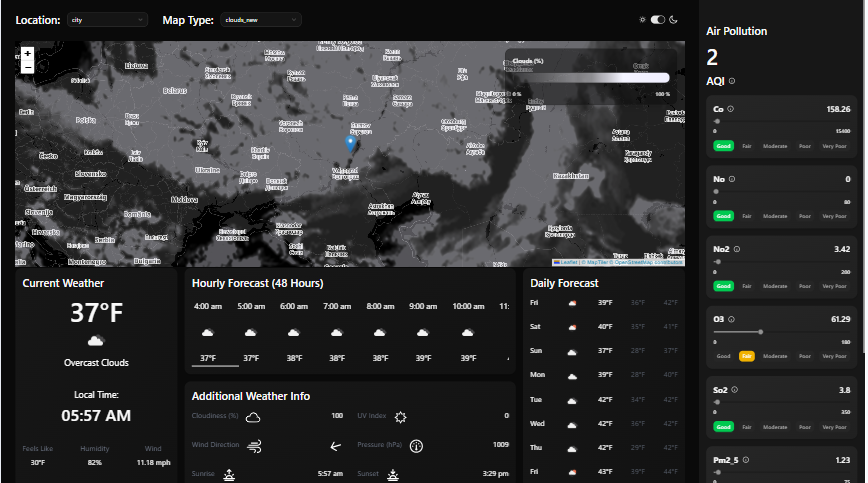
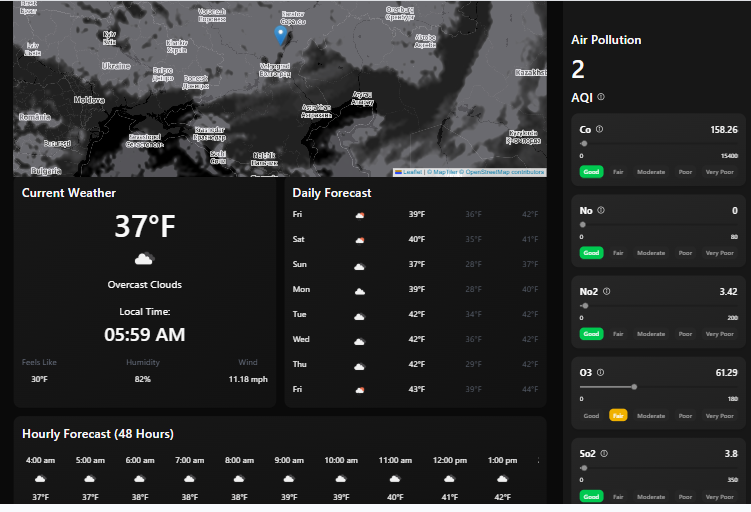
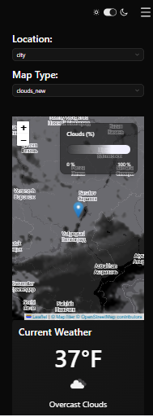

# Climora – Weather Intelligence Dashboard

A modern, responsive weather dashboard built with React and TypeScript, providing real-time weather conditions, detailed forecasts, air quality insights, and interactive weather visualization.

## Features

- **Real-Time Weather:** View current weather conditions and essential meteorological information.
- **Hourly Forecast:** Explore upcoming weather conditions through hourly forecasts.
- **7-Day Forecast:** Get an overview of weather conditions for the next seven days.
- **Air Quality Monitoring:** Access air quality information and pollutant levels.
- **Interactive Weather Map:** Visualize weather conditions using interactive maps and different weather layers.
- **Location Search:** Search for cities and retrieve their weather information.
- **Predefined Locations:** Quickly switch between predefined locations.
- **Responsive Design:** Optimized layouts for desktop and mobile devices.
- **Light & Dark Themes:** Switch between light and dark appearance modes.

## Tech Stack

- **React** – Component-based UI development.
- **TypeScript** – Static typing and improved code reliability.
- **Tailwind CSS** – Utility-first styling and responsive layouts.
- **shadcn/ui** – Reusable and customizable UI components.
- **TanStack Query (React Query)** – Server-state management, caching, and data synchronization.
- **Zod** – Runtime validation of API responses.
- **React-Leaflet** – Interactive map integration.
- **OpenWeather API** – Weather forecasts and air quality data.

## Key Concepts & Implementation

- **API Integration:** Fetching and handling external weather data.
- **Server-State Management:** Managing asynchronous API data using TanStack Query.
- **Suspense Queries:** Handling asynchronous data loading with React Suspense.
- **Skeleton Loaders:** Improving perceived loading performance with placeholder UI.
- **Responsive Design:** Building adaptive layouts for different screen sizes.
- **State Management:** Managing application state and user interactions.
- **Theme Management:** Implementing light and dark modes.
- **Runtime Validation:** Ensuring API responses match expected data structures using Zod.
- **Component-Based Architecture:** Building reusable and maintainable UI components.
## Screenshots

## Screenshots

| Desktop Dashboard | Weather Details |
|:---:|:---:|
|  |  |

| Additional Weather Details | Mobile Dashboard |
|:---:|:---:|
|  |  |

## Live Demo

Coming soon — deployment in progress.
